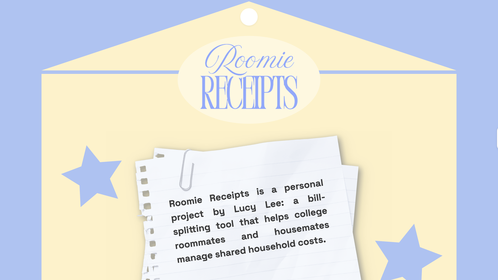
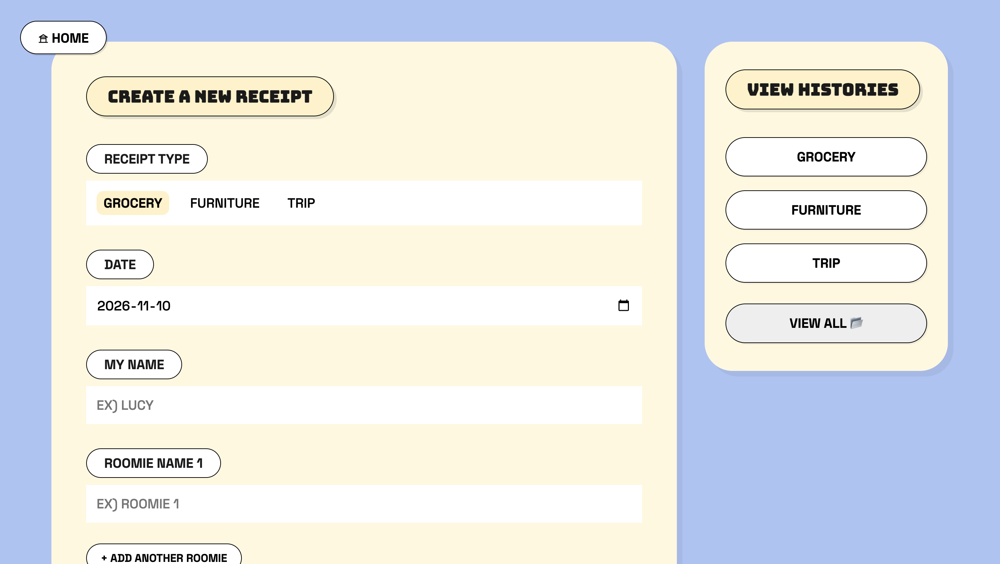
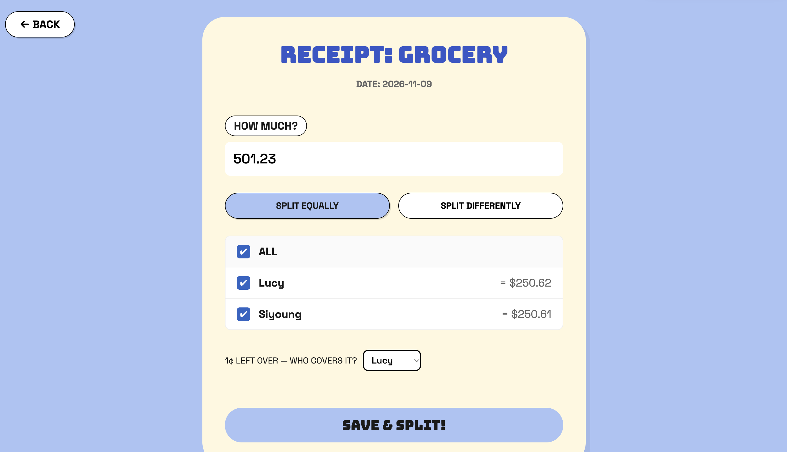
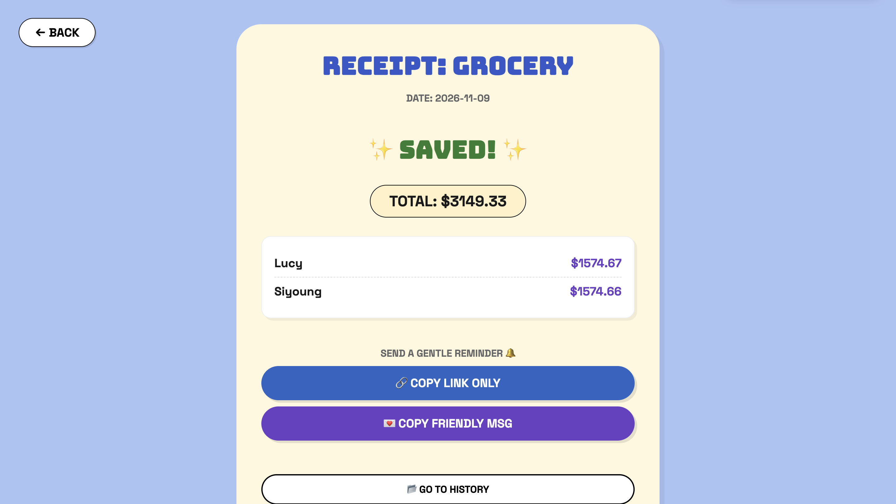
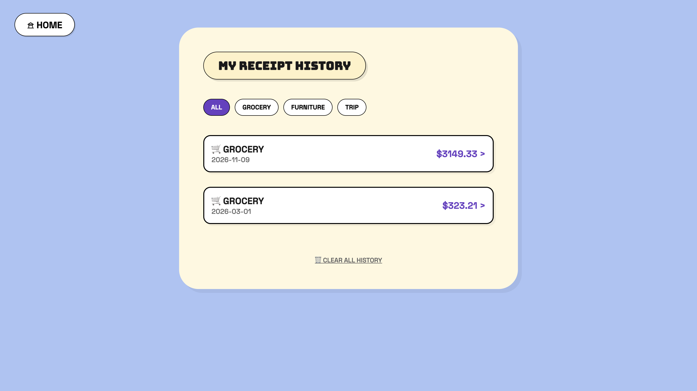

# 🧾 Roomie Receipts

> **Split shared bills with your roommates, without the awkward conversation.**

Roomie Receipts is a no-login web app for splitting groceries, furniture and trip costs with roommates. Create a receipt, split it equally or by exact amounts, and share one link.

👉 **[Try it live](https://roomie-receipts.pages.dev)**

---

## ✨ Features

- **No login, no app download.** Create a receipt and share the link in under a minute.
- **Split equally or by exact amounts.** With two people, typing one amount fills in the other.
- **Every cent accounted for.** $10.00 split three ways is $3.34 + $3.33 + $3.33, and you choose who covers the extra cent. Custom splits show a live "left to assign" counter and only save when they add up.
- **Friendly reminders.** Copy the link, or a ready-made message for your group chat.
- **History on your device.** Receipts you created are listed in your browser for quick access.
- **Accessible.** Real form labels, full keyboard support, inline error messages and WCAG AA colour contrast.
- **Works on phones.** Layouts, tap targets and number keypads designed for small screens.

---

## 🔁 What changed in v2 (Nov 2026)

v1 shipped in early 2026. A year later I audited it against WCAG and money-accuracy standards and rebuilt it.

| Area | v1 | v2 |
| --- | --- | --- |
| Rounding | $10 ÷ 3 lost a cent ($9.99 total) | Integer-cent math; leftover cents shown and assigned |
| Saving | Totals were never stored (write to a missing column, error ignored) | Errors handled; server re-checks that shares add up |
| Privacy | Database open to anyone with the public key | RLS on; data only reachable by a receipt's exact link |
| Accessibility | Thin all-caps display font, contrast as low as 1.8:1, mouse-only controls, alert pop-ups | Readable body font, ≥ 4.5:1 contrast, keyboard support, inline errors |
| Mobile | Laptop-only layouts | Responsive layouts, 44px tap targets |
| Honesty | Advertised receipt scanning and PDF export that didn't exist | Only real features listed |

The original version is tagged [`v1`](../../tree/v1).

---

## 🔒 How data is protected

There are no accounts, so **the link is the key**: anyone with a receipt's link can view and edit that one receipt, and nobody can list or read other receipts.

- Row Level Security is enabled on both tables with no public policies, so the browser can't query them directly.
- The app only calls three Postgres functions (`create_receipt`, `get_receipt`, `save_split`) that work on a single receipt ID. See [`supabase/v2_security.sql`](supabase/v2_security.sql).
- Receipt IDs are random UUIDs, so links can't be guessed.

---

## 🛠️ Tech stack

- **Frontend:** React, Vite, react-router-dom
- **Styling:** custom CSS; Bungee (display) + Space Grotesk (body)
- **Backend:** Supabase (Postgres, RLS, RPC functions)
- **Hosting:** Cloudflare Pages

---

## 🚀 Run locally

```bash
npm install
cp .env.example .env   # then fill in your Supabase URL and publishable key
npm run dev
```

To set up a fresh Supabase project, run [`supabase/v2_security.sql`](supabase/v2_security.sql) in the SQL Editor (it lists the steps in order).

---

## 📸 Screenshots

| Landing Page | Create Receipt |
|:---:|:---:|
|  |  |

| Split & Detail | Saved Result |
|:---:|:---:|
|  |  |

| Saved Histories |
|:---:|
|  |

---

Made by [Lucy Lee](https://github.com/lucy2sy).
